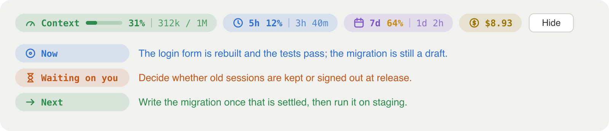

# context-meter

A Claude Code mod that puts your usage above the prompt box, so you stop opening the context popover to check it.



*A drawing of the band with sample values, made from the mod's own drawing code.*

A 19-second walkthrough is in [`docs/demo.mp4`](docs/demo.mp4). It is an animated mock of the desktop app, drawn in `video/demo.html` and rendered by `video/render.mjs`, not a screen recording.

## What it shows

One row above the prompt:

- **Context**: how full the context window is, as a bar, a percentage and tokens over the window.
- **5h** and **7d**: your plan's five-hour and seven-day limits, as a percentage and the time until each resets.
- **Cost**: what the session has cost so far at API list prices. On a subscription this is not a charge.
- **Recap**: a button. Press it and the mod asks the model three things about the current session: where the work stands, what is waiting on you, and what comes next. The answer appears under the row and clears when you send your next message.

A percentage turns amber at 60% and red at 85%.

It also keeps a quiet record of cost per day. Type `/spend` to list the total for each of the last 14 days, summed across every session that has the mod loaded.

## Install

The Claude Code documentation asks for 2.1.287 or later for mods.

To try it in one session:

```bash
git clone https://github.com/justerification/claude-code-context-meter
claude --plugin-dir ./claude-code-context-meter
```

To load it in every session, including the desktop app, add the folder to the `env` block of `~/.claude/settings.json`:

```json
{
  "env": {
    "CLAUDE_CODE_PLUGIN_DIRS": "~/path/to/claude-code-context-meter",
    "CLAUDE_CODE_PLUGIN_DIR_WATCH": "1"
  }
}
```

The second line makes the desktop app reload the mod when you edit its files. Both are read when a session starts.

## What it costs to run

The pills cost nothing: they read figures Claude Code already has. Each press of **Recap** is one extra model call over the session's transcript, mostly served from the prompt cache. Nothing is spent until you press it.

## Limits

- Claude Code reports only the five-hour and seven-day windows to mods. A per-model weekly limit and cloud session credits cannot be shown.
- The desktop app draws mod buttons itself, so the Recap button cannot be styled to match the pills.
- The daily cost record covers Claude Code sessions on one machine. It is kept in `~/.claude/mods-data/context-meter/cost/`, one small file per session per day.
- The pills are drawn as one SVG in the desktop app. The terminal gets a plain text row.
- The mods API is early access and changes between releases. This was built and used on 2.1.286 in the desktop app, on macOS.

## Changing it

Everything is in `hooks/register.tsx`. The colours are in `HUES`, the thresholds in `tone`, the pills in `pillsOf`, and the Recap question in `WHERE_PROMPT`. Check an edit with:

```bash
claude plugin validate .
```

## Licence

MIT.
