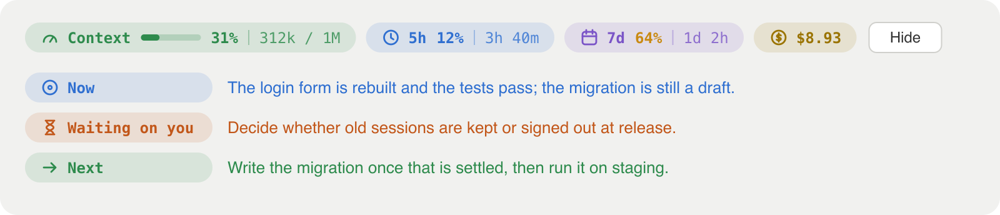

# context-meter

A Claude Code mod that puts your usage above the prompt box, so you stop opening the context popover to check it.



*A drawing of the band as it was in version 1.0, made from the mod's own drawing code. Version 1.1 has no Recap button, and its plan pills follow your plan (see below).*

A 19-second walkthrough of version 1.0 is in [`docs/demo.mp4`](docs/demo.mp4). It is an animated mock of the desktop app, drawn in `video/demo.html` and rendered by `video/render.mjs`, not a screen recording.

## What it shows

One row above the prompt:

- **Context**: how full the context window is, as a bar, a percentage and tokens over the window.
- **5h** and **All**: your plan's five-hour and weekly all-models limits, as a percentage and the time until each resets. A pill shows only if your plan has that window.
- **A pill per model with its own weekly limit**, named as your plan names it (for example **Fable**), in the same form.
- **Cost**: what the session has cost so far at API list prices. On a subscription this is not a charge.

A percentage turns amber at 60% and red at 85%.

It also keeps a quiet record of cost per day. Type `/spend` to list the total for each of the last 14 days, summed across every session that has the mod loaded.

## Install

The Claude Code documentation asks for 2.1.287 or later for mods.

To try it in one session:

```bash
git clone https://github.com/justerification/claude-code-context-meter
claude --plugin-dir ./claude-code-context-meter
```

To load it in every session, including the desktop app, add the folder to the `env` block of `~/.claude/settings.json`:

```json
{
  "env": {
    "CLAUDE_CODE_PLUGIN_DIRS": "~/path/to/claude-code-context-meter",
    "CLAUDE_CODE_PLUGIN_DIR_WATCH": "1"
  }
}
```

The second line makes the desktop app reload the mod when you edit its files. Both are read when a session starts.

## What it costs to run

No tokens: the mod makes no model calls.

It does start a second process. Claude Code hands mods only the five-hour and seven-day figures, so for the per-model weekly limits the mod runs a second `claude` after a turn, at most once every three minutes, and asks it for the plan's usage report:

```
claude -p --input-format stream-json --output-format stream-json --verbose --no-session-persistence --settings '{"disableAllHooks":true,"env":{"CLAUDE_CODE_PLUGIN_DIRS":"","CLAUDE_CODE_PLUGIN_DIR_WATCH":"0"}}'
```

with one `get_usage` control request on its standard input. That process sends no prompt, runs none of your hooks, loads no mods, saves no session and exits in about a second. It reads your plan usage with the sign-in Claude Code already has; the mod never sees a credential. To switch this off, delete the two `refreshPlanQuietly($)` lines in `hooks/register.tsx`.

## Limits

- The `get_usage` request is marked experimental in Claude Code. If the per-model pills vanish after an update, that is the first thing to check.
- Cloud session credits cannot be shown.
- The daily cost record covers Claude Code sessions on one machine. It is kept in `~/.claude/mods-data/context-meter/cost/`, one small file per session per day.
- The pills are drawn as one SVG in the desktop app. The terminal gets a plain text row.
- The mods API is early access and changes between releases. Version 1.1 was built and used on 2.1.317 in the desktop app, on macOS.

## Changing it

Everything is in `hooks/register.tsx`. The colours are in `HUES`, the thresholds in `tone`, the pills in `pillsOf`, and the usage report in `refreshPlan`. Check an edit with:

```bash
claude plugin validate .
```

## Not affiliated

This is an independent project. It is not affiliated with or endorsed by Anthropic; Claude and Claude Code are named only to say what the mod works with.

## Licence

MIT.
